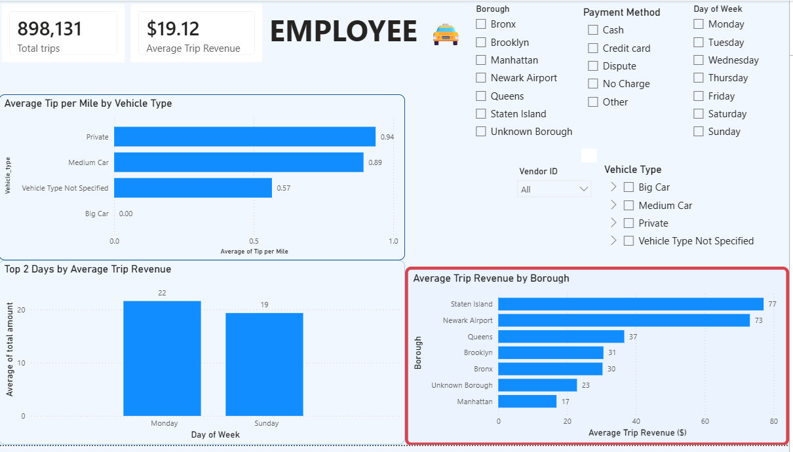
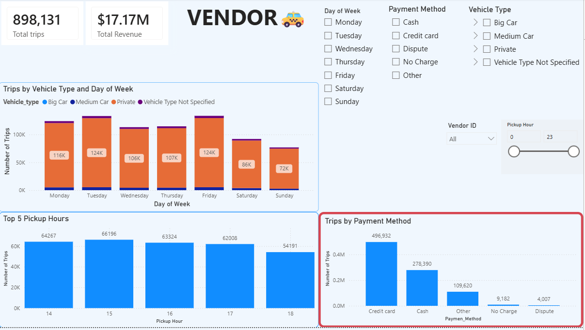

# NYC Yellow Taxi Analysis | Power BI

## Project Overview
This project analyzes NYC Yellow Taxi trip data using Power BI to explore trip patterns, revenue, and passenger tipping behavior.

## Tools and Skills
- Power BI Desktop
- Power Query – data cleaning and transformation
- DAX – calculated measures and KPIs
- Data modeling and relationships
- Interactive dashboards and data visualization

## Dashboard Pages

### 1. Taxi Trip Analysis

### 2. Revenue and Trip Insights

## Project Purpose
This portfolio project demonstrates my practical skills in data analysis, data modeling, DAX, and interactive reporting with Power BI.
